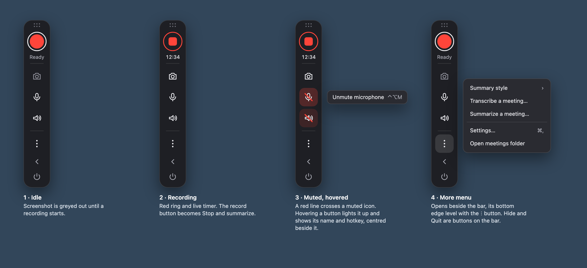
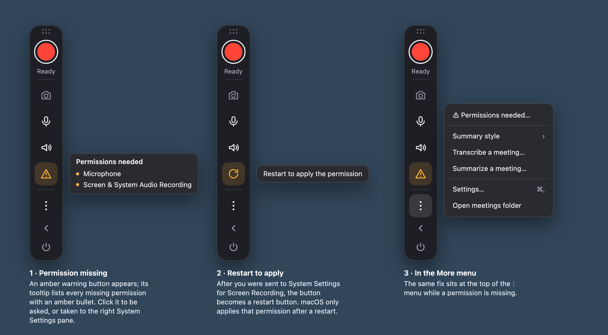
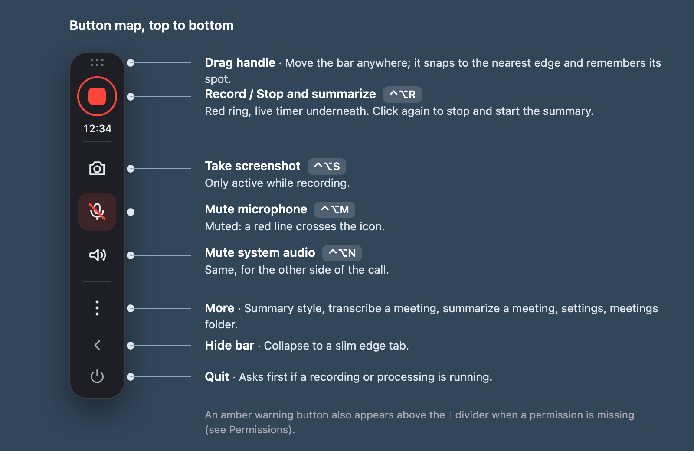
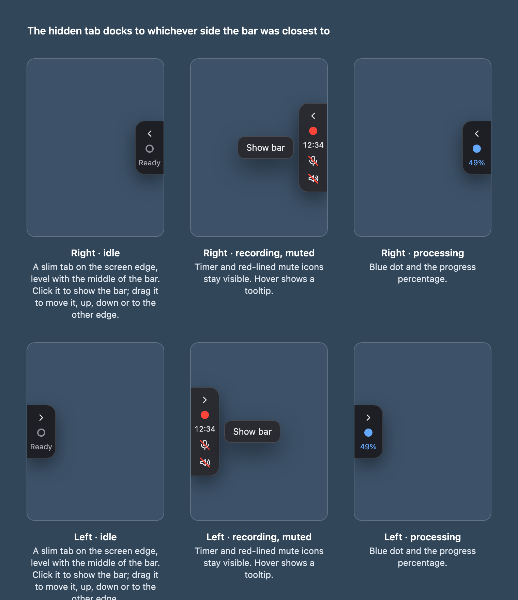
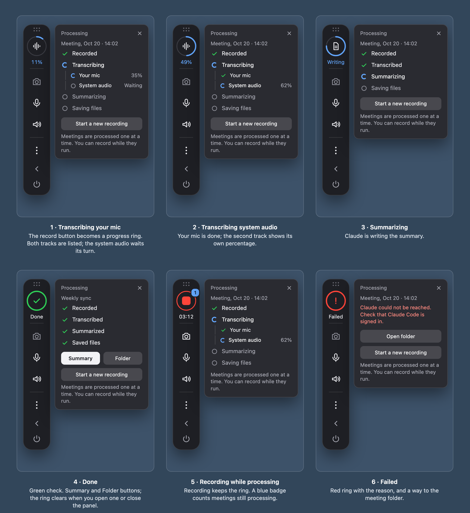
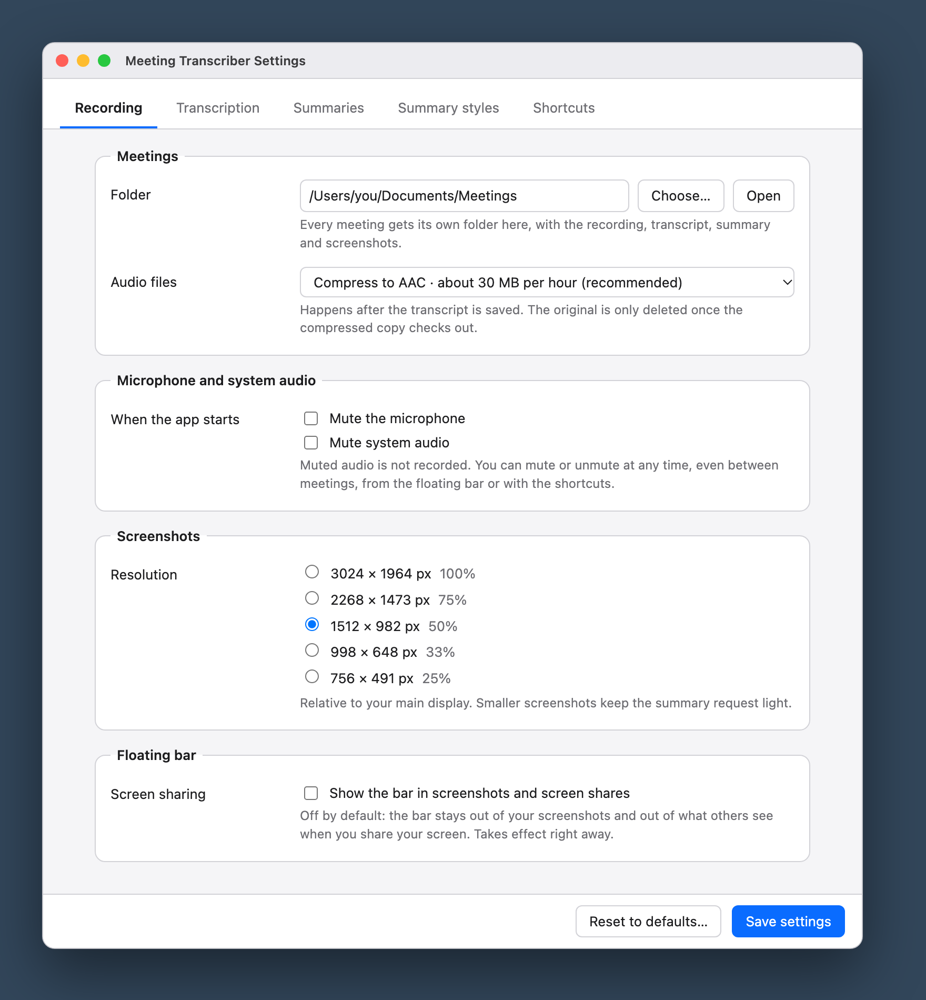
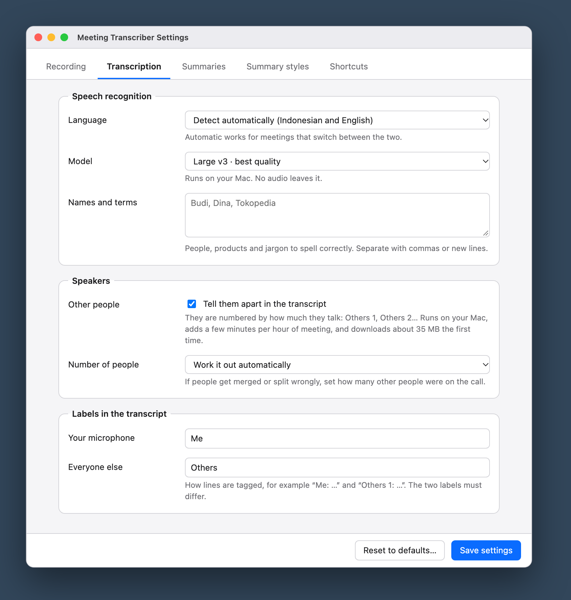
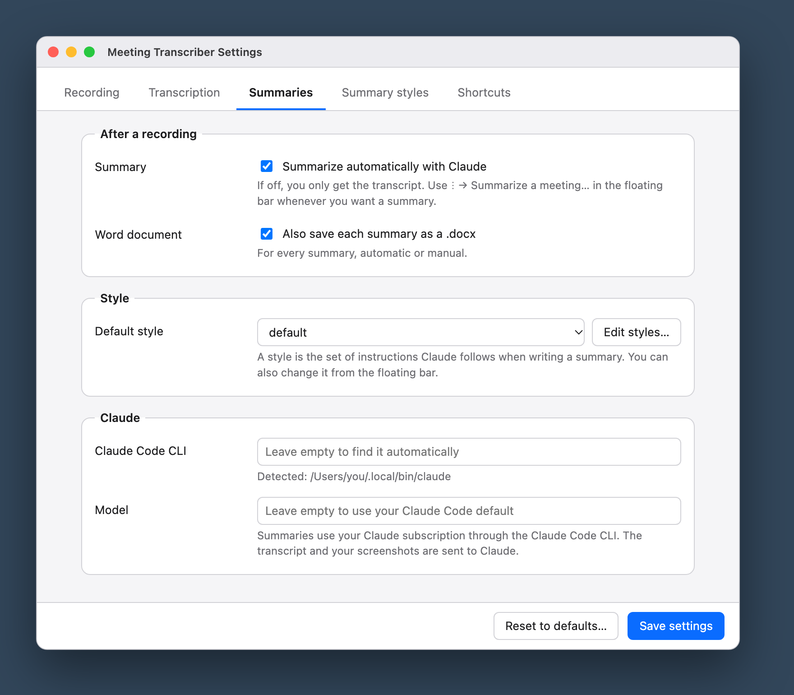
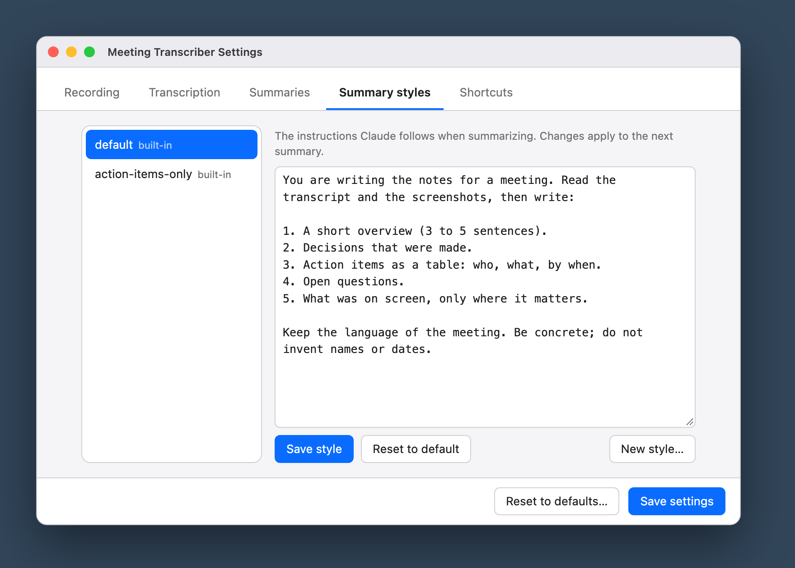
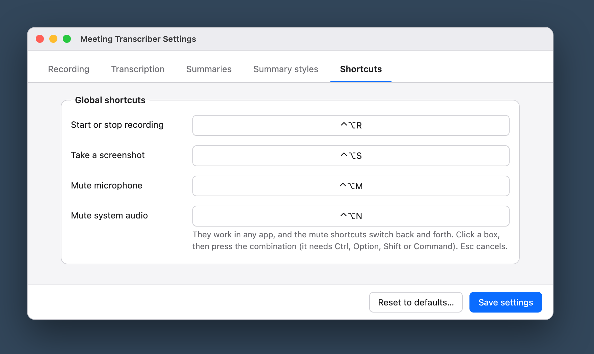

# Meeting Transcriber

**A small floating bar for your Mac that listens to your meetings and writes the notes for you.**

Start recording with a shortcut, and grab a screenshot of a slide with another. When you stop, the app
turns the conversation into a written transcript (Indonesian and English) and asks Claude to write a tidy
summary with the decisions and action items. You get a Word document and a text file, ready to share.

<p align="center">
  
</p>

| | |
|---|---|
| **Works on** | macOS 13 or newer, Apple Silicon (M1 or later). Windows is planned, not available yet |
| **Transcription** | Done on your own Mac with Whisper. Your audio never leaves your computer |
| **Summaries** | Written by Claude, using your Claude subscription. No API key needed |
| **Cost** | Free app. Summaries use your existing Claude plan |

> **Privacy:** to write the summary, the *transcript* and the *screenshots you took* are sent to Claude
> (Anthropic). Audio is never uploaded. If you turn off *Summarize automatically with Claude* in Settings,
> nothing is sent anywhere until you choose to summarize a meeting yourself.
> Please tell the people in your meeting that you are recording.

---

## Contents
1. [What you get](#what-you-get)
2. [Get started](#get-started)
3. [Everyday use](#everyday-use)
4. [Where your files go](#where-your-files-go)
5. [Settings](#settings)
6. [Good to know](#good-to-know)
7. [Troubleshooting](#troubleshooting)
8. [For developers](#for-developers)
9. [Platform support](#platform-support)

---

## What you get

After every meeting, the app creates a folder containing:

- a **summary** (Word document and Markdown file) with the key decisions and action items,
- the **full transcript**, with timestamps and who said what ("Me" or "Others", or "Others 1", "Others 2"…),
- the **screenshots** you took. Claude picks the useful ones (slides, charts, documents) and places them
  in the right spot in the summary.

```
record  ──▶  transcribe (on your Mac)  ──▶  summarize (Claude)  ──▶  Word + Markdown summary
 your mic     "Me" / "Others"                picks the useful          folder renamed with
 + the other  with timestamps                screenshots; you pick     the meeting title
 side's audio                                the summary style
 + screenshots
```

---

## Get started

### What you need
- A Mac with **Apple Silicon** (M1 or newer) running **macOS 13 or later**.
- **Claude Code** (the app or the command-line tool), signed in to your Claude account. This is only needed for
  summaries; without it you can still record and transcribe. If you have the Claude desktop app, Meeting
  Transcriber finds the copy bundled with it automatically.
- **Apple's command line tools**: run `xcode-select --install` once.
- **Python 3.11 or newer.**
- About **3 GB of free space** for the speech model (downloaded on first use) plus room for your recordings.

### Install
Open Terminal in this folder and run:

```bash
./build_app.sh
```

This takes a few minutes the first time and creates **MeetingTranscriber.app** in this folder. Drag it to
Applications or the Dock, then double-click it. A small control bar appears on the edge of your screen.

- The first transcription downloads the speech model (about 3 GB, one time only).
- The app runs its code from **this project folder**. Keep the folder where it is; if you move it, run
  `./build_app.sh` again from the new location.
- Rebuilding changes the app's signature, so macOS may ask for permissions again afterwards.

### Allow two permissions
The first time you open the app it explains what it needs, then macOS asks for permission one at a time:

<p align="center">
  
</p>

| Permission | Why the app needs it |
|---|---|
| **Microphone** | to record your voice |
| **Screen & System Audio Recording** | to record the other participants' audio and to take screenshots (no video is recorded) |

- macOS asks only once. If you said no, an amber **⚠ Permissions needed** button appears on the bar. Click it
  and the app asks again or opens the right page in System Settings.
- After you switch on *Screen & System Audio Recording*, the button turns into a **restart** button. Click it
  and the app restarts by itself (macOS requires this).
- Without microphone access the app won't record. Without screen access it records your microphone only and tells you so.

---

## Everyday use

### The floating bar

Everything is controlled from a small bar on the edge of your screen. Hover any button to see its name and shortcut.

<p align="center">
  
</p>

| I want to… | Do this |
|---|---|
| Start or stop a recording | Click the record button, or press **Ctrl + Option + R**. Stopping also processes the meeting |
| Take a screenshot | The camera button, or **Ctrl + Option + S**. The screen under your mouse flashes white to confirm |
| Mute your microphone | The mic button, or **Ctrl + Option + M** |
| Mute the other people (system audio) | The speaker button, or **Ctrl + Option + N** |
| Pick how the summary is written | **⋮ → Summary style** |
| Summarize or re-summarize a past meeting | **⋮ → Summarize a meeting…**, then pick its folder |
| Transcribe a meeting again (new model, language or names) | **⋮ → Transcribe a meeting…**, then pick its folder |
| Change settings | **⋮ → Settings…** (⌘ ,) |
| Open the folder with all meetings | **⋮ → Open meetings folder** |

Shortcuts work in any app and need no extra permission. If another app already uses a combination, you get a notification.

**Muting.** Works any time, even before you start recording, and carries over to the next recording. A muted
button gets a red line across it. Muted audio is replaced with silence before it is saved, so it cannot be
recovered. The transcript marks the stretch as `(Me muted)` / `(Me unmuted)`.

**Move it.** Drag the bar by its grip or any empty part. A dashed preview shows which screen edge it will snap to.
It remembers where you left it. Menus open on the side facing the middle of the screen.

**Hide it.** The arrow at the bottom collapses the bar into a slim tab that still shows the timer, progress
and mute state. Click the tab to bring the bar back, or drag it elsewhere.

<p align="center">
  
</p>

**Private by design.** The bar never steals focus from the app you are in, and by default it is kept out of
your screenshots and screen shares. To show it there, turn on *Settings → Recording → Floating bar*.

### After you stop

The record button turns into a progress ring and a panel lists the steps: transcribing your microphone,
transcribing the other side, summarizing, saving. When it is done you get **Summary** and **Folder** buttons.
You can start a new recording right away; a blue badge counts the meetings still being processed (they are
handled one at a time). If something goes wrong, the panel says why.

<p align="center">
  
</p>

### Summary styles

A **summary style** is simply a set of instructions for Claude. Two come built in:
- **default**: overview, decisions, action items, open questions, discussion points and what was on screen.
- **action-items-only**: just the decisions and a table of action items.

You can edit a style, create your own, rename or delete your own, or reset a built-in one in
**Settings → Summary styles**. Summarizing a past meeting again with another style (or to retry after an error)
works any time, even after restarting the app.

---

## Where your files go

Each meeting gets its own folder inside `~/Documents/Meetings` (changeable in Settings):

```
2026-10-07_1030 - Marketing Budget Review/
├── summary.docx            Word version of the summary, with the used screenshots embedded
├── summary-<style>.md      the summary as text, one file per style (e.g. summary-default.md)
├── transcript.md           the full transcript, with timestamps and screenshot markers
├── shots/                  every screenshot you took
├── recordings/             the audio (your mic and the other participants)
└── meta.json               timing information the app needs
```

- The folder name starts as the date and time. After the first summary, the **meeting title** is added.
  Summarizing again never renames it.
- Audio is first saved as WAV (safe even if the app crashes), then shrunk to about 30 MB per hour once the
  transcript is saved and the smaller file is verified.
- **Google Docs:** upload `summary.docx` to Google Drive and open it with Google Docs. Images are kept.
- Older meetings may have `transcript/transcript.md` and the audio files next to `meta.json`. They keep working.

---

## Settings

Open **Settings…** from the ⋮ menu (or ⌘ ,). Everything is checked before it is saved. Shortcuts and the bar
update immediately; other changes apply from the next recording.

### Recording

<p align="center">
  
</p>

| Setting | What it does | Default |
|---|---|---|
| Meetings → Folder | Where meetings are saved | `~/Documents/Meetings` |
| Meetings → Audio files | AAC (smallest, ~30 MB/hour), FLAC (lossless, ~110 MB/hour) or keep the WAV (~230 MB/hour) | AAC |
| Microphone and system audio → When the app starts | Start with the microphone and/or system audio muted | both off |
| Screenshots → Resolution | Size of saved screenshots, as pixel sizes and a percentage of your screen | 50% |
| Floating bar → Screen sharing | Show the bar in screenshots and screen shares | off |

### Transcription

<p align="center">
  
</p>

| Setting | What it does | Default |
|---|---|---|
| Speech recognition → Language | Detects Indonesian or English as people speak, or forces one | automatic |
| Speech recognition → Model | "Large v3" is the most accurate; "turbo" is about 4× faster but slightly less accurate | large v3 |
| Speech recognition → Names and terms | Names and jargon to spell correctly, e.g. *Budi, Dina, Tokopedia* | empty |
| Speakers → Other people | Numbers the other people on the call (Others 1, Others 2…) by voice. Downloads ~35 MB once and runs on your Mac | on |
| Speakers → Number of people | Work it out automatically, or set it if the app merges or splits someone | automatic |
| Labels | The names shown in the transcript for you and for everyone else (must differ) | Me / Others |

### Summaries

<p align="center">
  
</p>

| Setting | What it does | Default |
|---|---|---|
| After a recording → Summary | Summarize automatically with Claude. If off, the app only transcribes | on |
| After a recording → Word document | Also save each summary as `.docx` | on |
| Style → Default style | The style used for summaries | default |
| Claude → CLI and model | Leave empty to find Claude Code and use your usual model | empty |

### Summary styles and Shortcuts

**Summary styles** is where you edit, create, rename or delete styles. **Shortcuts** holds the four global
shortcuts: click a box and press the combination you want (it needs at least one modifier key).

<p align="center">
  
  
</p>

**Reset to defaults…** restores the original settings and keeps your old file as `config.toml.bak`.

Settings are stored in `~/Library/Application Support/MeetingTranscriber/config.toml`. You can edit that file
by hand too (see [`config.example.toml`](config.example.toml)); the app keeps your comments when it saves. If the
file has a typo, you get a notification and the previous settings stay in effect.

---

## Good to know

- **Very long meetings:** the whole transcript and all screenshots go to Claude in one request. The app sets
  no limit of its own (only a 30-minute timeout), but Claude's limits apply. A very long meeting or dozens of
  screenshots can make the summary fail. Your transcript and audio are already saved, so retry with **Summarize a meeting…**.
- **Microphone:** the app uses whichever microphone macOS has selected. If you switch mid-meeting (for example
  AirPods connect, or a mic is unplugged), it follows the new default within a few seconds and fills the gap with
  silence. With no microphone available it keeps retrying.
- **Other participants:** the app records everything your Mac plays, from all apps mixed, whatever speakers or
  headphones you use.
- **Telling people apart** is by voice only, so it can't know names and it makes mistakes: two similar voices may be
  merged, one person with a varying tone may be split, and a short remark can land on the wrong person. If the count
  looks wrong, set *Number of people* under Settings → Transcription → Speakers.
- **Echo:** without headphones your mic also hears the speakers. The app drops most of this, but headphones give
  cleaner results.
- **Accuracy:** language is detected for each burst of speech, so a switch mid-sentence can garble a few words, and very
  short or quiet words are sometimes misheard. Add names to *Names and terms* to help; words from the meeting
  folder's title (after the " - ") are added automatically.
- **Made-up text:** Whisper sometimes invents "Terima kasih." or "Thank you." out of silence. Such segments are dropped,
  so a real, very quiet one-word "thank you" could occasionally go missing.
- **Stopping** can freeze the menu for a few seconds while the audio is closed.
- **Not yet tested** on a long real call with live system audio, hotkeys and microphone together.

---

## Troubleshooting

| Problem | What to do |
|---|---|
| The icon disappears right after launch | Read `~/Library/Logs/MeetingTranscriber.log` |
| "Claude Code CLI not found" | Install Claude Code, or set its path under Settings → Summaries → Claude |
| Screenshot error about Screen Recording | Allow the app in System Settings → Privacy & Security, then restart it |
| A meeting failed to process or summarize | **⋮ → Summarize a meeting…**, or use the command line below |
| The summary fails on a very long meeting | See "Very long meetings" above |
| Other participants are silent in the transcript | The transcript starts with a ⚠ warning when a track was silent (stretches you muted yourself don't count). Check the Screen & System Audio Recording permission |

---

## For developers

### Dependencies

| Part | What it uses |
|---|---|
| Language | Python 3.11+, plus Swift (command line tools) for two small helpers |
| Transcription | [`mlx-whisper`](https://github.com/ml-explore/mlx-examples) (Apple Silicon), `numpy` |
| Speaker separation | `sherpa-onnx` (pyannote segmentation + 3D-Speaker embeddings, on CPU) |
| Audio capture | `sounddevice` (mic), the `sck-audio` Swift helper (ScreenCaptureKit, system audio) |
| macOS integration | `pyobjc-framework-Quartz`, `-WebKit`, `-AVFoundation`; `Pillow` for screenshots |
| Word export | `pypandoc_binary` (bundles pandoc) |
| MCP server | `mcp` |
| Summaries | the Claude Code CLI (`claude -p`), not a Python package |

Python packages are listed in [`requirements.txt`](requirements.txt).

### Build
`build_app.sh` builds the `sck-audio` Swift helper, creates `.venv` and installs `requirements.txt`, compiles a
small native launcher, assembles `MeetingTranscriber.app`, ad-hoc code-signs it and registers the icon. The app is a
thin launcher that starts `.venv/bin/python -m mt.app` from the project folder, so macOS attributes permissions to
the app instead of to Terminal or a bare Python binary. Logs go to `~/Library/Logs/MeetingTranscriber.log`.

Run the tests with `.venv/bin/python -m pytest tests` (install `pytest` first if needed).

### How recording works
- **Microphone:** `sounddevice` input stream on the default input device, 16 kHz mono, written to `recordings/mic.wav`.
  A watchdog reopens the stream when the default input changes, disappears or stops delivering audio (gap padded with silence).
- **System audio:** the `sck-audio` helper uses ScreenCaptureKit on the first display (all system audio, excluding the app
  itself) and writes `recordings/system.wav`. It reports the start time of the first buffer so tracks can be aligned.
- **Screenshots:** captured with Quartz at the real pixel resolution of the display under the mouse, scaled by
  `screenshot_scale`, saved as `shots/shot_<seconds>.jpg` (JPEG quality 80). A white flash window confirms each capture.
- **Hotkeys:** Carbon `RegisterEventHotKey`, which needs no Accessibility or Input Monitoring permission.
- **`meta.json`** stores the start time, duration and the offsets that align mic, system audio and screenshots, plus
  `mic_muted` / `system_muted` (muted spans, in seconds from the start) and `mic_device_events` when the microphone changed
  mid-recording (`changed` / `stalled`, `reopened` with the new device name).
- **Muting** replaces audio with silence at the source (zeros in the mic callback; `--muted` flag plus `MUTE`/`UNMUTE`
  commands on the `sck-audio` helper's stdin). Files keep running, so they stay aligned with the clock and screenshots.

### How transcription works
Each track is cut into bursts of speech and each burst is transcribed on its own with mlx-whisper, with exact timestamps;
silence is skipped. Mic bursts whose loudness envelope mirrors the system audio (speaker bleed) are dropped before and
after transcription. Language is detected per burst (a pause of 1.5 s or more starts a new one), limited to
`allowed_languages`; very short bursts reuse the previous burst's language. Roughly 30× faster than real time on Apple Silicon.

If speaker separation is on, the system track is also run through sherpa-onnx (`mt/diarize.py`): pyannote segmentation
cuts it into speech turns, grouped by voice (3D-Speaker embeddings, CPU, ~25× real time). The groups are deliberately too
fine; each is averaged into one voiceprint and groups whose voiceprints are close (cosine distance below 0.35) are
merged, tiny groups first. Each Whisper segment gets the speaker who talks most during it. The two models (~35 MB)
are downloaded to `~/Library/Application Support/MeetingTranscriber/models` the first time; if that fails, the
transcript is made without numbering and says so at the top.

The result is `transcript.md`: `[hh:mm:ss] Speaker: text` lines plus `(screenshot: shots/…)` markers.

### How summarizing works
`mt/summarize.py` runs `claude -p` with the chosen prompt, the transcript and a calendar of the next 15 days (so "next
Friday" resolves correctly) on stdin. Claude may read only `./shots/*` (`--allowedTools "Read(./shots/*)"`). The output is
saved as `summary-<style>.md`; the Word export (pandoc via `pypandoc`) and the folder renaming use it.

### Security
Meeting content (speech and what is on screen) is untrusted input to Claude:
- Claude can read only `shots/*` of the current meeting, and the prompt tells it to treat transcript text as data, never as instructions.
- The Word export embeds only real image files directly inside `shots/`. Any other image reference (URLs, `../` paths)
  becomes a text placeholder, so nothing is fetched or pulled in from elsewhere on disk.
- The Settings window is a native window with a local page; it talks to the app through a message handler (no web
  server, no open port) and every request is validated.

### Configuration reference
All keys of `config.toml` (the Settings window edits the same file in place):

| Key | Default | Notes |
|---|---|---|
| `meetings_dir` | `~/Documents/Meetings` | where meetings are saved |
| `model` | `mlx-community/whisper-large-v3-mlx` | `…-large-v3-turbo` is ~4× faster, slightly less accurate |
| `language` | `"auto"` | per-burst detection, or force `"id"` / `"en"` |
| `allowed_languages` | `["id", "en"]` | languages auto-detection may pick (config file only) |
| `vocabulary` | `[]` | names/terms to spell correctly |
| `diarize`, `diarize_speakers` | `true`, `0` | tell the other people apart; `0` = work out how many, or a number up to 12 |
| `my_label`, `others_label` | `Me`, `Others` | speaker names in the transcript; must differ |
| `compress_audio` | `"aac"` | `"flac"` or `"off"` |
| `auto_summarize` | `true` | `false` = transcribe only |
| `export_docx` | `true` | also write `summary.docx` with every summary |
| `default_prompt` | `"default"` | prompt file name without `.md` |
| `screenshot_scale` | `50` | percent (10–100) of the screen's real pixel size |
| `claude_path`, `claude_model` | auto, Claude Code's default | |
| `start_muted_mic`, `start_muted_system` | `false` | start the app with that side muted |
| `overlay` | `true` | show the floating control bar |
| `overlay_in_captures` | `false` | show the bar in screenshots and screen shares |
| `hotkey_record`, `hotkey_screenshot`, `hotkey_mute_mic`, `hotkey_mute_system` | `<ctrl>+<alt>+r` / `s` / `m` / `n` | modifiers `<ctrl> <alt> <shift> <cmd>` plus a letter, digit or `<f1>`…`<f20>`; must differ |

Prompts live in `~/Library/Application Support/MeetingTranscriber/prompts/` (copied from `prompts/` on first run).

### Command line (no app)
```bash
.venv/bin/python -m mt.cli record                                      # Enter = stop, s+Enter = screenshot
.venv/bin/python -m mt.cli process <meeting-dir>                       # transcribe + summarize
.venv/bin/python -m mt.cli summarize <meeting-dir> action-items-only   # (re-)summarize, optional style name
```

### Optional: ask Claude Desktop about past meetings (MCP)
Add this to `claude_desktop_config.json`, then ask things like "what did we decide on Tuesday?":
```json
"meetings": {"command": "/ABS/PATH/meeting-transcriber/.venv/bin/python",
             "args": ["-m", "mt.mcp_server"], "cwd": "/ABS/PATH/meeting-transcriber"}
```
The server reads the meetings folder from your settings when it starts. Tools: `list_meetings`, `get_transcript`,
`get_summary` (latest, or a given style), `get_screenshot`, `list_summary_prompts`.

### Project layout
| Path | Purpose |
|---|---|
| `mt/app.py` | the app: actions, permission flow, glue to the bar |
| `mt/overlay.py`, `mt/ui/overlay.html`, `mt/ui/popup.html` | the floating bar, its menu, tooltips and status panel |
| `mt/jobs.py`, `mt/progress.py` | progress of the meetings being processed |
| `mt/recorder.py`, `mt/flash.py` | recording, screenshots, screenshot flash |
| `mt/transcribe.py`, `mt/audio.py` | Whisper transcription, echo handling, audio compression |
| `mt/diarize.py` | telling the other people apart (sherpa-onnx) |
| `mt/pipeline.py`, `mt/summarize.py`, `mt/docx_export.py` | processing flow, Claude summary, Word export |
| `mt/config.py`, `mt/settings_api.py`, `mt/settings_window.py`, `mt/ui/settings.html` | settings storage, validation and window |
| `mt/hotkeys.py`, `mt/permissions.py` | global hotkeys, macOS permissions |
| `mt/cli.py`, `mt/mcp_server.py` | command line, MCP server |
| `sck-audio/`, `launcher/` | Swift helpers: system-audio capture, app launcher |
| `prompts/`, `assets/` | built-in summary styles, icons |
| `docs/screenshots/` | design mockups used in this README |
| `tests/` | unit tests |

---

## Platform support

The app is macOS-only today. A Windows version is planned; the macOS-specific pieces are listed so the work can be split up:

| Area | macOS (today) | Windows (planned) |
|---|---|---|
| System audio | `sck-audio` (Swift, ScreenCaptureKit) | WASAPI loopback |
| Transcription | `mlx-whisper` | `faster-whisper` |
| Screenshots | Quartz | `mss` / Pillow |
| Floating bar | `NSPanel` + WKWebView (PyObjC) | a topmost frameless window |
| Settings window | WKWebView (PyObjC) | `pywebview` (WebView2), same `settings.html` |
| Hotkeys | Carbon `RegisterEventHotKey` | Win32 `RegisterHotKey` |
| Audio compression | `afconvert` | `ffmpeg` |
| Packaging | `build_app.sh`, `.app` bundle | PyInstaller or similar, plus an installer |

Already portable: the processing pipeline, summarizing, the Word export, settings validation, prompts, the CLI and the
MCP server. Contributions toward Windows support are welcome.

Summaries come only from the **Claude Code CLI**, using your own Claude subscription. There is no API key and no other
AI provider. Transcription does not use Claude and works without it.
